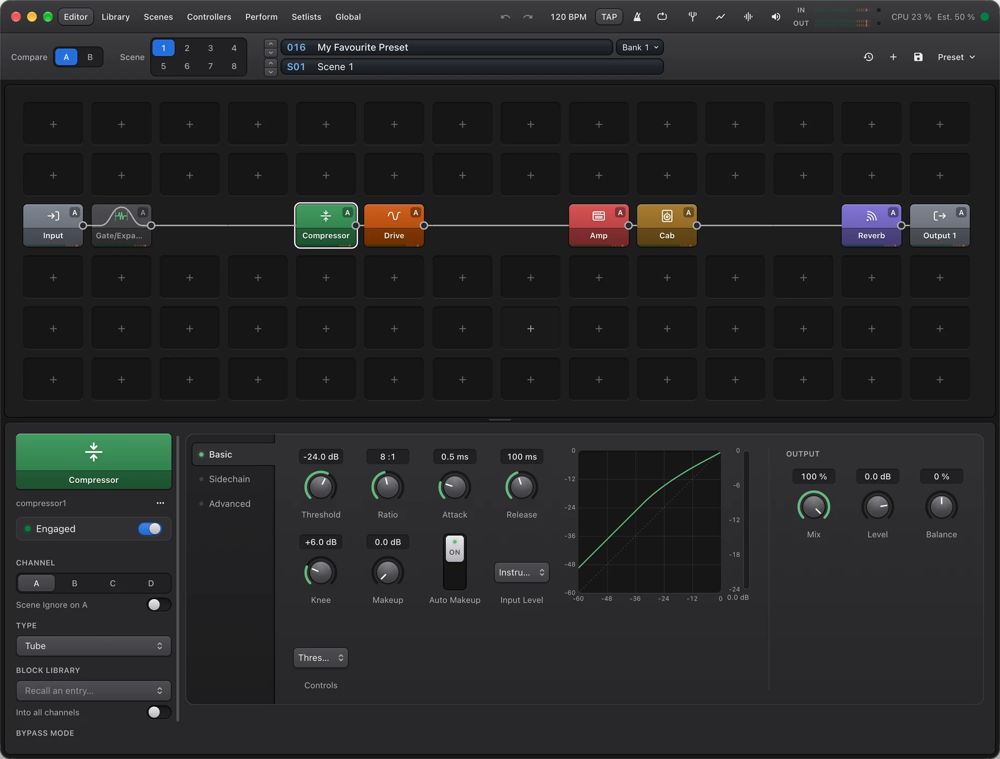

# Cathode

**A guitar processor for your computer, in the spirit of the Axe-Fx III.** Plug your guitar into an audio interface and
build a rig from circuit-modelled amps, cabinets, drives and effects on a grid, with scenes, channels and modifiers for
playing live. It runs on your Mac or PC, or on a small Linux computer in your rig that you control from any browser.



Cathode is free and open source (GPL-3.0-or-later).

> **Status: release candidate.** 1.0.0-rc.3 is the third release candidate; see the [changelog](CHANGELOG.md). Presets
> saved from 1.0 on keep loading in later releases.

## What it does

- **88 amp models**, each built from its schematic: stage by stage, with the tone stack, power amp, transformer and
  speaker load, and the amp's own front-panel controls. Plus expert settings (tubes, bias, sag, supply) behind them.
- **Neural captures:** load NAM (`.nam`) and AIDA-X models in the Amp NAM block.
- **Cabinets:** a Cab block that builds the response from 10 speakers, 11 microphones and 7 cabinets, with mic
  position, distance and angle. Load your own impulse responses (`.wav`, `.cabgrid`) too, mix them, trim them, or
  capture one with a sine sweep.
- **49 block types:** drives, delays (including multi-tap, ten-tap and plex delays), reverbs, chorus, flanger, phaser,
  rotary, tremolo, wah, pitch and harmonisers, synth, vocoder, compressors and gates, EQs, filters, a looper, a
  tuner, mixers and FX loops.
- **A grid like the hardware's:** six rows of fourteen cells, parallel paths, mixers and feedback loops.
- **Built for playing live:**
  - eight scenes per preset, and four channels per block;
  - modifiers driven by LFOs, envelopes, a sequencer or MIDI controllers;
  - a Perform page with big controls;
  - MIDI control and footswitch layouts;
  - a metronome and tap tempo.
- **A library:**
  - presets with banks and setlists, snapshots and templates;
  - block presets;
  - NAM amps and IR cabs, all in one place.
- **Several inputs and outputs:** up to six inputs, four stereo outputs with their own EQ, an FX loop, and a DI out
  for reamping.

## Download

Get the latest build from the [Releases page](https://github.com/Rikarin/cathode/releases).

| Package | For | Notes |
|---|---|---|
| `Cathode-<version>-mac-arm64.dmg` | macOS on Apple Silicon | Not notarised yet: on first launch, right-click the app and choose Open. |
| `Cathode-<version>-win-x64.exe` | Windows 10 and 11 | Not signed yet: SmartScreen asks you to confirm. |
| `Cathode-<version>-linux-x86_64.AppImage` | Linux desktops | Make it executable (`chmod +x`) and run it. |
| `cathode-server-<version>-linux-<x64\|arm64>.tar.gz` | A small Linux computer in your rig, with no display | See [the headless rig](#a-headless-rig). |

Each release lists `SHA256SUMS` to check the downloads against. Every file and `SHA256SUMS` itself carry a signed
build-provenance attestation: `gh attestation verify <file> --repo Rikarin/cathode` shows it was built by this
repository's release workflow ([verifying a download](docs/10-releases.md#verifying-a-download)).

### Where it plays sound today

| Platform | Audio and MIDI |
|---|---|
| macOS | ✅ CoreAudio and CoreMIDI |
| Linux | ◐ ALSA (direct, no sound server) and JACK or PipeWire, with ALSA sequencer MIDI, early: tested in containers, not yet on a real interface |
| Windows | ◐ WASAPI and WinMM MIDI, early: tested on shared-mode output only (exclusive mode and inputs still need a real interface); ASIO planned |

Without a working audio driver, Cathode runs on a silent "null" backend: you can build and edit presets, but you will
not hear them.

## Getting started

1. Connect your audio interface and open Cathode.
2. Open **Settings** (⌘, on a Mac, Ctrl+, elsewhere), go to **Audio setup**, and choose your interface, its sample
   rate and buffer size. 64 samples at 48 kHz is the target. A loopback test there measures your real latency.
3. Double-click an empty cell on the grid to add a block. An Amp and a Cab between Input and Output make a rig.
4. Select a block to edit it in the drawer below the grid. Right-click a knob to add a modifier or put it on the
   Perform page.
5. Save with ⌘S. Press `?` to see every keyboard shortcut.

Your presets and assets are stored in Cathode's data folder (`~/Library/Application Support/Cathode` on a Mac).

## A headless rig

The `cathode-server` package runs the engine and the server on a small Linux computer (a Raspberry Pi 5 or a mini PC)
with your audio interface, and serves the editor to the network. You play and edit from a phone, a tablet or a
laptop's browser, or from the desktop app's remote-server connection.

```sh
tar xzf cathode-server-<version>-linux-arm64.tar.gz
cd cathode-server-<version>-linux-arm64
sudo ./install.sh
```

The installer starts Cathode at every boot and prints the address to open and an access token. See
[packaging/headless/README.md](packaging/headless/README.md) for choosing the audio interface, updates and logs.

## Licence and trademarks

Cathode is free software: you can redistribute it and modify it under the terms of the GNU General Public License,
version 3 or (at your option) any later version. See [LICENSE](LICENSE).

Cathode is not affiliated with or endorsed by Fractal Audio Systems. Axe-Fx is their trademark. Amplifier, speaker and
microphone names belong to their owners and are used only to say which equipment a model is based on.

---

## Development

### Repository layout

| Folder | What's in it |
|---|---|
| [`engine/`](engine) | The C# (.NET 10) engine: the DSP library, the NativeAOT real-time host (`cathode-host`), the ASP.NET Core server (`cathode-server`, REST and WebSocket API), the native audio and NAM shims (`engine/native`), tests and tools. See [engine/README.md](engine/README.md). |
| [`editor/`](editor) | The Angular editor and the Electron desktop app (an Nx workspace). See [editor/README.md](editor/README.md). |
| [`website/`](website) | The project's website: an Angular page prerendered to static HTML. See [website/README.md](website/README.md). |
| [`packaging/`](packaging) | The headless rig package: build script, installer and systemd services. |
| [`docs/`](docs) | The design: [architecture](docs/02-architecture.md), [testing](docs/03-testing-strategy.md), [plan](docs/04-implementation-plan.md), [amp modelling](docs/06-amp-modelling-spec.md), [amp catalogue](docs/07-amp-catalogue.md), [block parity](docs/08-blocks-parity.md), [parity tracker](docs/09-parity-tracker.md), [releases](docs/10-releases.md) and the [ADRs](docs/adr). |

The engine runs as two processes: an allocation-free NativeAOT host that owns the audio thread, and a server that holds
presets and serves the API, so its garbage collection never touches the audio. Blocks are described once (a descriptor
of parameters and pages) and that drives the DSP, the API's validation, the editor's generated controls and the tests.

### Build

You need the .NET 10 SDK, Node with pnpm, and CMake with a C and C++20 compiler (on Linux, also `libasound2-dev`).

```bash
cd engine && native/build.sh && dotnet build -c Release
```

```bash
cd editor && pnpm install
```

### Run

The desktop app starts the engine host and the server itself:

```bash
cd editor && pnpm exec nx serve desktop
```

For quick UI work in a browser, run the server with the engine in-process (no audio) and the editor's dev server:

```bash
cd engine && dotnet run -c Release --project src/Cathode.Server -- --Cathode:Engine:Mode=inprocess
```

```bash
cd editor && pnpm exec nx serve editor
```

The server listens on `http://127.0.0.1:5180`, with OpenAPI at `/openapi/v1.json`;
[`cathode.http`](engine/src/Cathode.Server/cathode.http) walks through the API. To run the host on a real device as a
separate process, see [engine/README.md](engine/README.md).

### Test

```bash
cd engine && dotnet test -c Release
```

```bash
cd editor && pnpm exec nx run-many -t test
```

```bash
cd editor && pnpm exec nx e2e desktop
```

The engine suite covers every block (generated conformance tests, zero allocation on the audio thread), the amp
models against circuit simulations of their schematics, golden renders and the API. The desktop end-to-end tests drive
the real Electron app with the engine on the null backend.

### Release

Push a version tag (`v1.2.3`) and [release.yml](.github/workflows/release.yml) builds every package on its own OS and
publishes a GitHub release. See [docs/10-releases.md](docs/10-releases.md).
